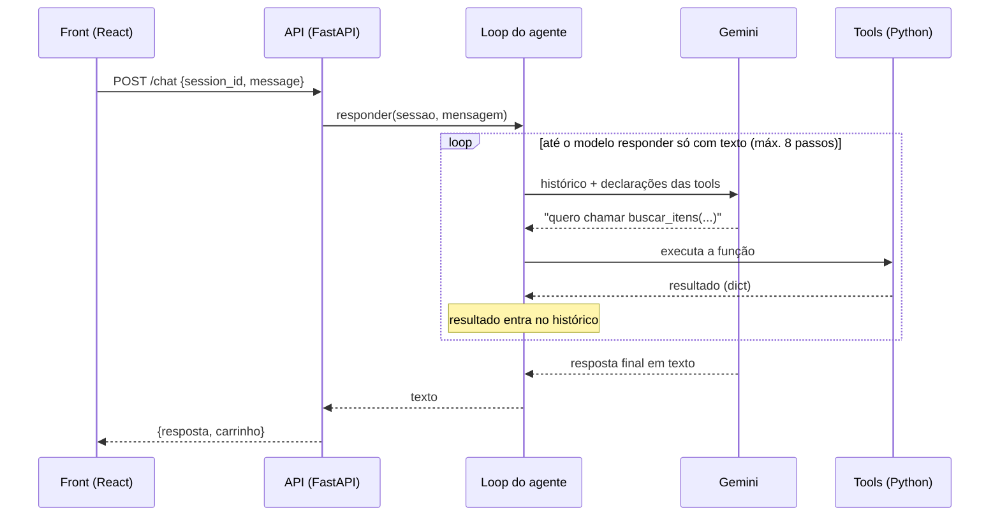

# Agente de Pedidos com IA

Um agente conversacional que entende pedidos de comida em linguagem natural e monta um carrinho usando **tool calling**, com o loop do agente escrito à mão (sem LangChain nem frameworks de agente).

> "quero algo leve pro jantar, até R$40, sem lactose"
>
> O agente busca nos cardápios, escolhe o *Frango grelhado com legumes* (R$ 34,90 + R$ 4,99 de entrega = R$ 39,89), adiciona ao carrinho e explica a escolha.

Projeto de portfólio de engenharia com IA generativa. Os restaurantes e cardápios são fictícios.

## Arquitetura



O ponto central: **o modelo nunca executa nada**. Ele só devolve "quero chamar a tool X com os argumentos Y". Quem executa é o código em `app/agent.py`, que devolve o resultado ao modelo e repete até vir uma resposta em texto.

| Arquivo | Papel |
|---|---|
| `data/restaurantes.json` | 7 restaurantes e 64 itens fictícios, com preço e tags |
| `app/tools.py` | As 5 tools (funções Python puras) e suas declarações em JSON Schema |
| `app/agent.py` | O loop manual do agente |
| `app/prompts.py` | System prompt com as regras de negócio |
| `app/session.py` | Histórico e carrinho por `session_id`, em memória |
| `app/api.py` | FastAPI: `POST /chat` e `GET /health` |
| `evals/` | Casos de teste e o script que mede a taxa de acerto |
| `web/` | Front em React + TypeScript + Vite + Tailwind |

### Tools

- `buscar_itens(texto, preco_max, tags)`: busca nos cardápios; cada item volta com o restaurante e a taxa de entrega
- `detalhes_restaurante(restaurante_id)`
- `adicionar_ao_carrinho(item_id, quantidade)`
- `remover_item(item_id)`
- `ver_carrinho()`: itens, subtotal, taxa de entrega e total

Regras de negócio que ficam no código, não no prompt: o carrinho aceita **um restaurante por vez**, e erros voltam para o modelo como `{"erro": "..."}` para ele decidir o que fazer (avisar o usuário, tentar outra coisa).

## Como rodar

Pré-requisitos: Python 3.12, Node 20+ e uma chave do Gemini ([Google AI Studio](https://aistudio.google.com/)).

**1. Back**

```bash
python -m venv .venv
.venv\Scripts\activate        # Windows (no Linux/macOS: source .venv/bin/activate)
pip install -r requirements.txt
```

Crie um arquivo `.env` na raiz:

```
GEMINI_API_KEY=sua_chave
```

Suba a API (documentação interativa em `http://localhost:8000/docs`):

```bash
uvicorn app.api:app --reload
```

Ou converse direto no terminal, sem API nem front:

```bash
python -m app.cli
```

**2. Front**

```bash
cd web
npm install
npm run dev
```

Abre em `http://localhost:5173`. Por padrão o front chama `http://localhost:8000`; para apontar para outra API, defina `VITE_API_URL`.

## Evals

Em vez de avaliar o texto da resposta (difícil de checar em código), o eval olha o **carrinho final** de cada conversa e confere expectativas objetivas:

```json
{"id": "orcamento-01", "pedido": "quero algo leve pro jantar, até R$40, sem lactose",
 "deve_ter_itens": true, "preco_max_total": 40, "tags_obrigatorias": ["leve", "sem_lactose"]}
```

São 31 casos em `evals/casos.jsonl`, em seis grupos:

| Grupo | Casos | O que mede |
|---|---|---|
| `simples` | 5 | Pedir um item pelo nome e na quantidade certa |
| `orcamento` | 8 | Respeitar o orçamento no total, com a taxa de entrega |
| `restricao` | 7 | Respeitar restrições alimentares (todas as tags em todos os itens) |
| `impossivel` | 5 | Não inventar: se nada atende, o carrinho fica vazio |
| `pergunta` | 1 | Não adicionar nada quando o usuário só perguntou |
| `conversa` | 5 | Mais de um turno: trocar, remover, somar, misturar restaurantes |

Cada falha tem um tipo (`orcamento`, `tags`, `carrinho_vazio`, `deveria_estar_vazio`, `item_esperado`, `restaurante`, `quantidade`, `erro`), então o resultado mostra onde o agente erra, não só quanto.

```bash
python -m evals.run_evals                 # suíte inteira
python -m evals.run_evals orcamento-01    # só alguns casos
```

### Resultados

**Ainda não há resultados.** A suíte precisa de cerca de 90 requisições ao modelo e o free tier do `gemini-3.6-flash` permite 20 por dia; a cota acabou no segundo caso da primeira rodada. O script detecta cota diária esgotada e aborta sem salvar resultados parciais.

O que foi validado até aqui: o checador acusa corretamente os tipos de falha quando recebe carrinhos montados à mão, e o único caso que chegou a rodar (`simples-01`) passou.

## Decisões

- **Loop manual, sem framework.** O loop tem cerca de 20 linhas e deixa visível o que um framework esconderia: o histórico é o estado, e cada tool call é uma ida e volta ao modelo. A chamada automática de funções do SDK fica desligada.
- **Lógica determinística no código, julgamento no modelo.** Filtro de preço, tags e a regra de um restaurante são código. Escolher "a melhor opção leve" é o modelo.
- **Erros de negócio como dado, não exceção.** `{"erro": ...}` volta para o modelo, que lê e reage. Foi assim que ele explicou a regra de um restaurante ao usuário em vez de quebrar.
- **Taxa de entrega dentro do resultado da busca.** O orçamento do usuário vale para o total; com a taxa em cada item, o modelo consegue respeitá-lo sem chamada extra.
- **Busca por texto simples.** Conta quantas palavras do pedido aparecem no item (sem acento, minúsculas) e ordena por isso e por preço. Suficiente para 64 itens.
- **Sessão em memória.** Um dict por `session_id`. Simples de explicar e suficiente para uma demo.
- **API como casca fina.** `api.py` valida com Pydantic, chama o agente e devolve; nenhuma regra de negócio mora nela.
- **O front não calcula nada.** O carrinho da tela é sempre o que a API devolveu.

## Limitações e próximos passos

- **Rodar a suíte de evals** com cota suficiente (outro modelo ou plano pago), registrar a taxa de acerto e ajustar o prompt a partir das falhas.
- **Sessão em memória** some quando o servidor reinicia e não funciona com mais de uma instância. Próximo passo: Redis ou banco.
- **Busca por palavras** não entende sinônimos ("refri", "japa"). Próximo passo: embeddings.
- **Histórico cresce sem limite** dentro de uma sessão. Próximo passo: resumir ou truncar turnos antigos.
- **Sem streaming:** a resposta chega de uma vez, depois de todas as tool calls.
- **Espera em caso de limite:** quando o Gemini devolve 429, o agente espera 20 segundos antes de tentar de novo, e o usuário fica esperando junto.

## Deploy

Back no Render, front na Vercel.

1. **Render:** New → Blueprint, apontando para este repositório (o `render.yaml` já descreve o serviço). Preencha `GEMINI_API_KEY`; `FRONT_ORIGINS` fica para o passo 3.
2. **Vercel:** importe o repositório com *Root Directory* = `web` e a variável `VITE_API_URL` = URL do serviço no Render.
3. **De volta ao Render:** defina `FRONT_ORIGINS` com a URL do front na Vercel (libera o CORS) e faça um novo deploy.

No plano gratuito do Render o serviço dorme após um tempo sem uso: a primeira mensagem pode demorar cerca de um minuto, e as sessões em memória são perdidas.
